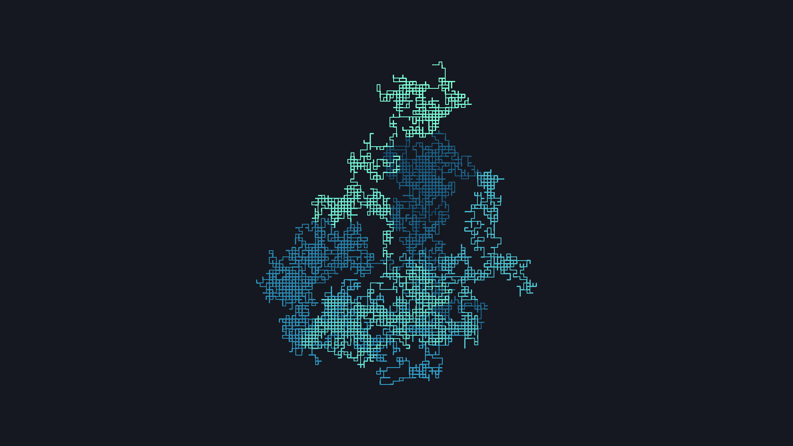
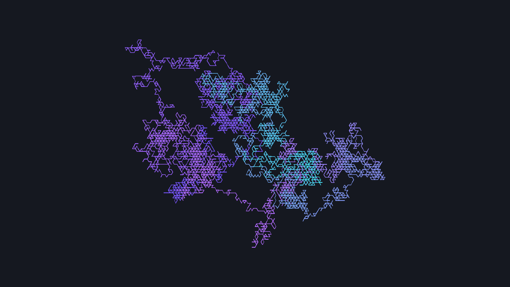
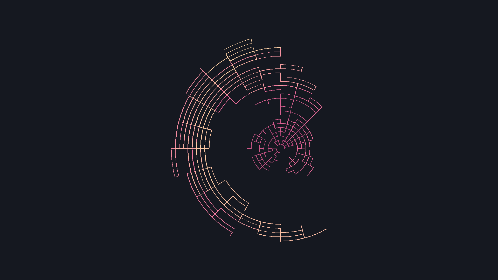

# Random Walk Wallpaper Generator

Генератор геометрических обоев на Python и Pillow.
Создаёт случайные узоры с плавными переходами цветов
из подобранных палитр

## Примеры

### Прямоугольная сетка



### Треугольная сетка



### Круговое блуждание



## Запуск

Для управления зависимостями используется [uv](https://docs.astral.sh/uv/).

Из корня проекта:

```bash
uv sync
uv run python -m generation_wallpaper.main
```

Изображения сохраняются в папку `img/`.
При повторном запуске файлы с совпадающими именами перезаписываются.

## Настройки

Настройки находятся в `src/generation_wallpaper/config.py`.

| Параметр | Назначение |
|---|---|
| `WIDTH`, `HEIGHT` | Разрешение изображения в пикселях |
| `PADDING` | Минимальный отступ рисунка от краёв |
| `BACKGROUND_COLOR` | Цвет фона |
| `LINE_WIDTH` | Толщина линий |
| `PALETTES` | Цветовые палитры |
| `IMAGE_COUNT` | Количество изображений за запуск |
| `OUTPUT_DIR` | Папка для сохранения |
| `PATTERN` | Тип узора |
| `STEP_RANGES` | Диапазон количества шагов для каждого типа |

Доступные типы узоров:

- `rectangular` — блуждание по прямоугольной сетке;
- `triangular` — блуждание по треугольной сетке;
- `circular` — движение по дугам окружностей и переходы между радиусами.

Например, для треугольного узора:

```python
PATTERN = "triangular"
```

Количество шагов выбирается случайно из соответствующего
диапазона `STEP_RANGES`. Направления движения также случайны,
поэтому каждый запуск создаёт новые рисунки.

## Как это работает

1. Выбранный алгоритм генерирует последовательность координат.
2. Рендер вычисляет границы рисунка, масштабирует и центрирует его,
   сохраняя пропорции.
3. Отрезки окрашиваются с плавным переходом по выбранной палитре.
4. Готовое изображение сохраняется в PNG.

## Структура проекта

```text
src/generation_wallpaper/
    config.py      # Настройки по умолчанию
    patterns.py    # Генерация координат и выбор алгоритма
    renderer.py    # Масштабирование, окраска и сохранение
    main.py        # Пакетная генерация
examples/          # Примеры обоев
```