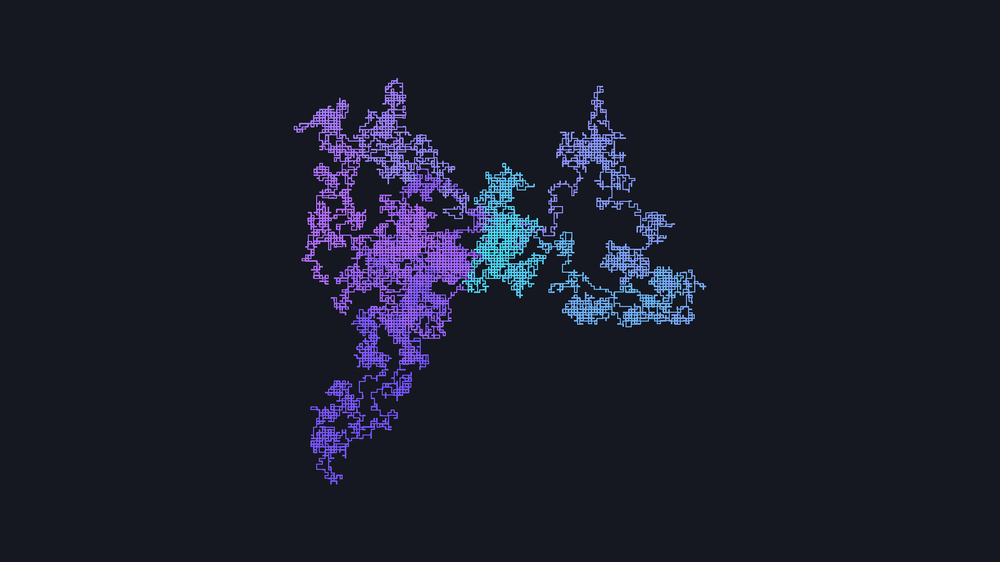
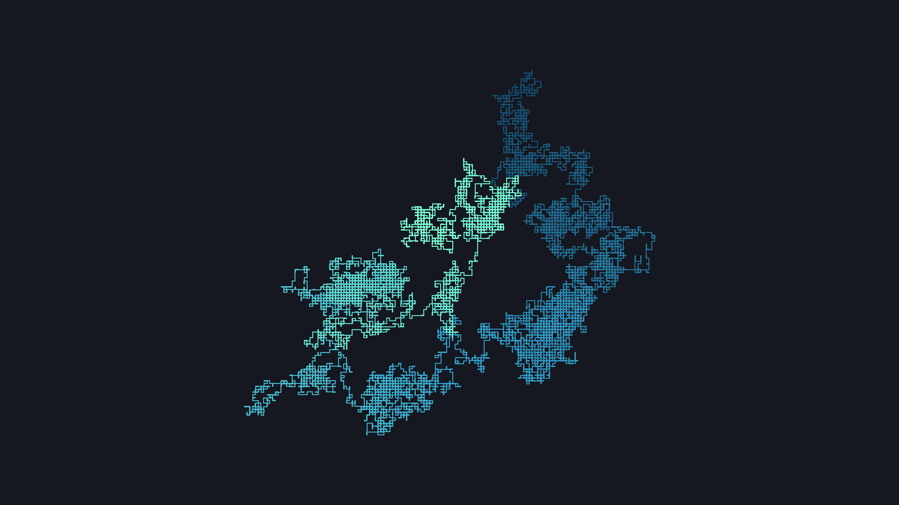

# Random Walk Wallpaper Generator

Генератор обоев на Python: случайное блуждание по двумерной
сетке с плавными переходами цветов из подобранных палитр.

## Примеры




## Запуск

Требуется установленный uv.

```bash
uv sync
uv run main.py
```

Скрипт создаёт 10 изображений размером 1920×1080 и сохраняет их в папку `img/`.
При повторном запуске предыдущие изображения перезаписываются.

## Настройки

В `main.py` можно изменить:

- количество изображений — в `main()`;
- диапазон количества шагов — `steps`;
- разрешение — `width`, `height`;
- отступы — `padding`;
- толщину линий — аргумент `width` у `draw.line()`;
- цветовые палитры — `PALETTES`;
- цвет фона — аргумент `color` у `Image.new()`.